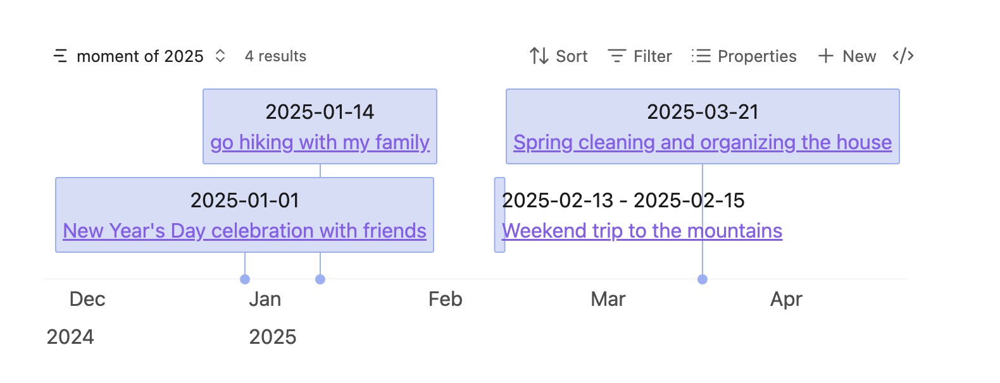
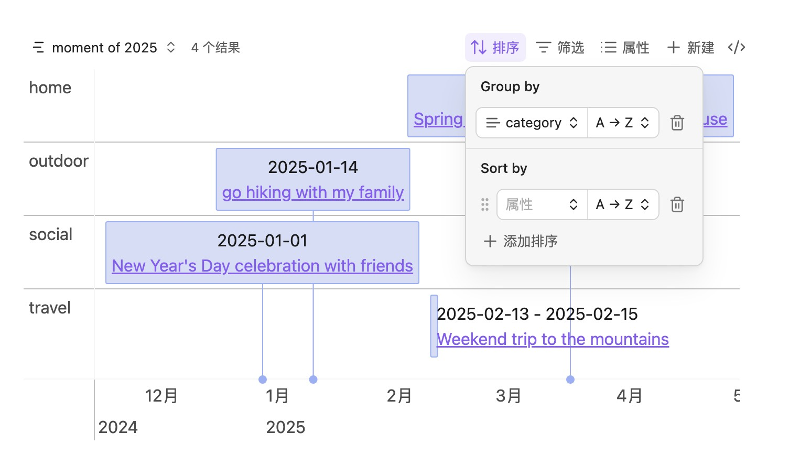
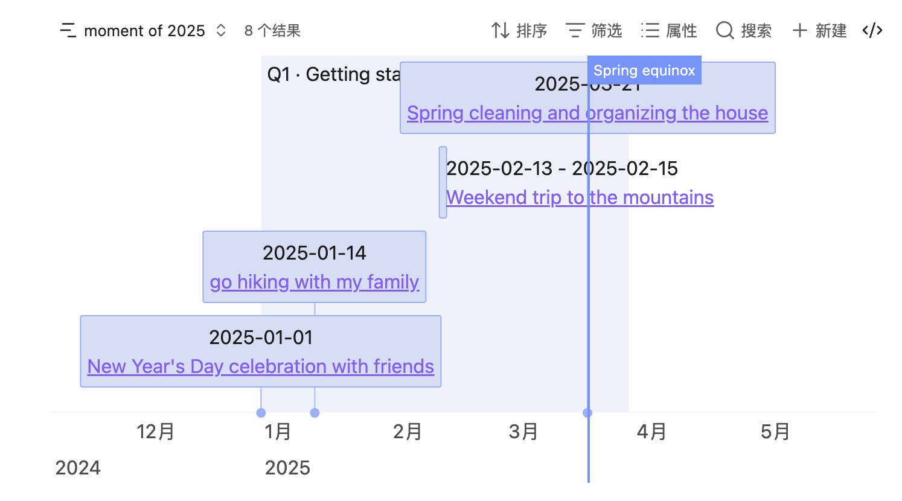
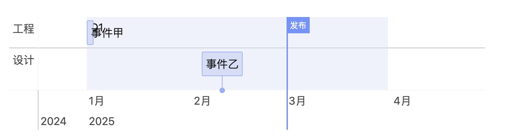

# obsidian-bases-timeline-view

Obsidian Bases 的时间线视图。

英文文档见仓库根目录 [README.md](../README.md)。

API 入参详见英文文档 [API reference](./api.md)。

## 功能

- **时间线**：按照时间线绘制笔记，从而直观的展示笔记的时间线信息。
- **分组**： 支持时间线条目分组，可按笔记任意字段分类并在视觉上分隔相关事件。
- **背景与标记（Bases）**：除了基础的时间线item外，还支持背景和marker的绘制。
- **渲染 API**：提供 API 供其他脚本调用，方便自定义绘制和扩展。
- **预览**: 时间线item支持Obsidian内置的预览功能，沉浸式查看相关内容。

## 示例

### 基本用法

要绘制时间线，需要先在笔记中添加属性，例如：

```markdown
start: 2025-01-01
end: 2025-01-04
content: title of the item
tags:

- moment
```

然后创建 Bases，并添加时间线视图：

```base
filters:
  and:
    - file.tags.contains("moment")
    - and:
        - file.ctime >= "2025-01-01"
        - file.ctime <= "2025-12-31"
views:
  - type: timeline-view
    name: moment of 2025
```

效果大致如下：


`timeline-view`会读取文件的frontmatter属性，并按照时间线绘制。
默认读取的文件frontmatter属性说明：

| 属性       | 说明                     | 必填 | 示例              | 备注                                      |
| ---------- | ------------------------ | ---- | ----------------- | ----------------------------------------- |
| start      | 开始日期                 | 否   | 2025-01-01        |                                           |
| date       | 开始日期                 | 否   | 2025-01-01        | 未设置 start 时使用 date                  |
| end        | 条目结束日期             | 否   | 2025-01-04        |                                           |
| content    | 条目内容/标题            | 否   | title of the item | 未设置时使用文件名                        |
| startLabel | 开始日期的展示文案       | 否   | start             |                                           |
| endLabel   | 结束日期的展示文案       | 否   | end               |                                           |
| cssclasses | 挂到 vis 条目上的 CSS 类 | 否   | phase-bg          | Obsidian 内置 list 属性；多个类用空格拼接 |

> 支持的时间格式有：
>
> - **文本（string）**：
>   - `YYYY`，如 `2025` → `2025-01-01`
>   - `YYYY-MM`，如 `2025-03` → `2025-03-01`
>   - `YYYY-MM-DD`，如 `2025-03-15`
>   - ISO 日期时间，如 `2025-03-15T12:30:00`，只取日期部分
>   - 带符号/扩展年份，如 `-0044`、`-0044-03-15`、`+010000-01-01`
> - **数字（number）**：整数年份，如 `2025` → `2025-01-01`（不是时间戳）
> - **日期（Obsidian frontmatter 提供的 Date / Date & time 类型）**：直接使用所选日期
>
> 月份和日期需要两位补零（`2025-1`、`2025-3-5` 不支持）；不支持 `2025/03/15`、自然语言等写法；`2025-02-30` 这类不存在的日期会被跳过。

### 自定义字段

若不想用默认属性名，可在视图中指定自定义属性，例如：

```base
filters:
  and:
    - file.tags.contains("moment")
    - and:
        - file.ctime >= "2025-01-01"
        - file.ctime <= "2025-12-31"
views:
  - type: timeline-view
    name: moment of 2025
    startField: note.startData
    endField: note.endData
```

请确保这些属性已在笔记中定义。

### 分组

Obsidian 1.10 及以上可使用 `group by` 对时间线条目分组，例如：


### 背景与标记

通过设置`backgroundWhen`和`markerWhen`来指定哪些笔记应该绘制成背景或标记。以下是示例：

```base
filters:
  or:
    - file.tags.contains("moment")
    - file.tags.contains("phase")
    - file.tags.contains("milestone")
formulas:
  isPhase: 'file.tags.contains("phase")'
  isMilestone: 'file.tags.contains("milestone")'
views:
  - type: timeline-view
    name: moment of 2025
    startField: note.start
    endField: note.end
    backgroundWhen: formula.isPhase
    markerWhen: formula.isMilestone
```



> - background笔记的frontmatter需要 `start` 和 `end`。
> - marker笔记的frontmatter需要 `start`（作为竖线时间）；`content` / 文件名作为标记标签。
> - 同时命中时的优先级：**marker** > **background** > **item**。
> - background同样支持group特性，可以按group分组绘制。

### 条目类型

默认情况下，设置了 `end` 的条目的 vis-timeline 类型是 range，否则是 box。若想逐条指定，可把视图的 **item type field** 指向一个值为 `box`、`point` 或 `range` 的属性：

```base
views:
  - type: timeline-view
    name: moment of 2025
    itemTypeField: note.timelineType
```

```markdown
timelineType: point
```

- 取值必须是精确的 `box`、`point` 或 `range`（区分大小写，与 vis-timeline 一致）；无法识别的值会回退到 vis 默认行为。
- `point` 条目会在 `start` 处绘制为圆点，`end` 与 `endLabel` 会被忽略。
- 只有配置了 **item type field** 才会读取该属性，因此笔记里无关的 `type:` frontmatter 不会造成影响。

### 自定义样式

插件提供三类 CSS 钩子，可以单独使用，也可以组合使用。插件自己的钩子都位于 `.timeline` 根类下。请优先使用插件提供的类，而不是 `.vis-item` 等 vis-timeline 内部类：插件保证自己的类名稳定，vis-timeline 的 DOM 结构可能随版本变化。

> [!warning] 从 1.9 之前的版本升级
> 旧版本编写的 CSS 片段需要相应修改：
>
> - 选取 item 元素时，用 `.timeline-item` 代替 `.vis-item`。
> - 条目内容的包装层从 `.timeline-item` 改名为 `.timeline-item-content`。
> - 例如 `.vis-item:has(.timeline-item[data-status='done'])` 需要改为
>   `.timeline-item:has(.timeline-item-content[data-status='done'])`。

1. **Item class**：读取笔记的 `cssclasses`（或视图中配置的 **class name field**），连同 `timeline-item` 一起写入 item 的 `className`；使用 `.timeline-item` 选取。
2. **Item data 属性**：把笔记的 tags 和 frontmatter 注入条目内容的 `.timeline-item-content` 包装层，生成 `data-tags` 和 `data-{字段}`。
3. **Background**：背景条目会额外获得 `timeline-background`、`timeline-background-odd` / `timeline-background-even`；同时 tags 和 frontmatter 会作为 `data-*` 属性写在同一个元素上，并额外包含从 1 开始的 `data-order`。

> 属性值规则：tags 用空格分隔写入 `data-tags`；数组值用空格连接；`Date` 输出为 `YYYY-MM-DD`；对象值会被跳过。

#### 1. Item class

```markdown
---
cssclasses:
  - phase-bg
---
```

```css
.timeline-item.phase-bg {
	background-color: rgba(211, 211, 211, 0.45);
	border-color: #d3d3d3;
}
```

#### 2. Item data 属性

条目属性位于 `.timeline-item-content` 包装层，因此需要在 item 上使用 `:has()`：

```css
.timeline-item:has(.timeline-item-content[data-tags~='#projects']) {
	border-width: 1px;
	border-style: solid;
}

.timeline-item:has(.timeline-item-content[data-status='not started']) {
	border-style: dashed;
}
```

#### 3. Background

背景的类和属性直接位于背景条目本身，不需要 `:has()`：

```css
.timeline-background-odd {
	background-color: rgba(0, 0, 0, 0.06) !important;
}

.timeline-background-even {
	background-color: rgba(0, 0, 0, 0.12) !important;
}

.timeline-background[data-phase='planning'] {
	// 自定义样式
}

.timeline-background[data-order='3'] {
	// 自定义样式
}
```

同一泳道内的背景会按 start/end 排序并从 1 重新编号；没有分组的全宽背景自成一条序列。`cssclasses` 同样会附加到背景的 `className` 上。

#### 完整示例

假设有一个 Base，把带 `#phase` 标签的笔记画成背景：

```base
filters:
  or:
    - file.tags.contains("moment")
    - file.tags.contains("phase")
formulas:
  isPhase: 'file.tags.contains("phase")'
views:
  - type: timeline-view
    name: roadmap
    backgroundWhen: formula.isPhase
```

普通事件笔记：

```markdown
---
start: 2025-01-05
end: 2025-01-09
content: 设计评审
status: not started
cssclasses:
  - phase-bg
tags:
  - projects
---
```

阶段背景笔记：

```markdown
---
start: 2025-01-01
end: 2025-03-31
content: Q1
phase: planning
tags:
  - phase
---
```

添加一个 CSS snippet：

```css
/* 1. Item class */
.timeline-item.phase-bg {
	background-color: rgba(211, 211, 211, 0.45);
	border-color: #d3d3d3;
}

/* 2. Item data 属性（在 .timeline-item-content 包装层上） */
.timeline-item:has(.timeline-item-content[data-tags~='#projects']) {
	border-width: 1px;
	border-style: solid;
}

.timeline-item:has(.timeline-item-content[data-status='not started']) {
	border-style: dashed;
}

/* 3. Background 类和属性（在背景条目本身） */
.timeline-background.timeline-background-odd {
	background-color: rgba(0, 0, 0, 0.06);
}

.timeline-background.timeline-background-even {
	background-color: rgba(0, 0, 0, 0.12);
}

.timeline-background[data-phase='planning'] {
	border-color: #7aa2f7;
}

.timeline-background[data-order='1'] {
	border-left-width: 3px;
}
```

渲染后大致为：

```html
<div class="timeline">
	<!-- 普通事件：class 在 .timeline-item，data-* 在 .timeline-item-content -->
	<div class="vis-item vis-range phase-bg timeline-item">
		<div class="vis-item-overflow">
			<div class="vis-item-content">
				<div
					class="timeline-item-content"
					data-tags="#projects"
					data-status="not started"
				>
					…
				</div>
			</div>
		</div>
	</div>

	<!-- 背景：class 和 data-* 都在背景条目本身 -->
	<div
		class="vis-item vis-background timeline-background timeline-background-odd"
		data-order="1"
		data-tags="#phase"
		data-phase="planning"
	>
		<div class="vis-item-overflow">
			<div class="vis-item-content">Q1</div>
		</div>
	</div>
</div>
```

## API

需要自行查询数据时（例如 DataviewJS），使用插件暴露的 `api`：

| 方法                                            | 适用场景                                                     |
| ----------------------------------------------- | ------------------------------------------------------------ |
| `api.render(containerEl, input, options?)`      | 已整理好的通用数据结构，完全自控                             |
| `api.dv.render(containerEl, sources, options?)` | 直接传入 Dataview 页面列表，插件负责字段映射与默认 item 模板 |

插件 id：`bases-timeline-view`。

```js
const api = app.plugins.plugins['bases-timeline-view']?.api;
if (!api) {
	// 插件未启用
	dv.paragraph('请升级并启用 Bases Timeline View');
} else {
	// 调用 api.render / api.dv.render
}
```

**完整入参、类型见 [API reference](./api.md)。**

### 快速示例：`api.render`

````markdown
```dataviewjs
const api = app.plugins.plugins['bases-timeline-view']?.api;
if (!api) {
  dv.paragraph('请先启用 Bases Timeline View 插件。');
} else {
  const items = [
    {
      id: 'notes/事件-甲.md',
      start: '2025-01-01',
      end: '2025-01-03',
      content: '事件甲',
      group: '工程',
    },
    {
      id: 'notes/事件-乙.md',
      start: '2025-02-10',
      content: '事件乙',
      group: '设计',
    },
  ];

  const backgrounds = [
    {
      id: 'notes/Q1.md',
      start: '2025-01-01',
      end: '2025-03-31',
      content: 'Q1',
      className: 'phase-bg',
    },
  ];

  const markers = [
    { id: 'launch', time: '2025-03-01', title: '发布' },
  ];

  api.render(this.container, { items, backgrounds, markers });
}
```
````



### 快速示例：`api.dv.render`

````markdown
```dataviewjs
const api = app.plugins.plugins['bases-timeline-view']?.api;
if (!api?.dv) {
  dv.paragraph('请先启用 Bases Timeline View 插件。');
} else {
	api.dv.render(this.container, {
		items: dv.pages('#event'),
		backgrounds: dv.pages('#phase'),
		markers: dv.pages('#milestone'),
	});
}

```
````

### 命令

在 Markdown 编辑器中打开命令面板，运行：

- **Insert custom render template** — 在光标处插入 `api.render` 的 DataviewJS 示例
- **Insert Dataview render template** — 在光标处插入 `api.dv.render` 的 DataviewJS 示例

预览这些代码块需要安装 [Dataview](https://github.com/blacksmithgu/obsidian-dataview) 插件。插入内容为英文示例。

## 提示

- Bases 视图与 `api` / `api.dv.render` 使用同一套日期归一化，所有输入最终转为 `YYYY-MM-DD`。
- `"2025"`、`"2025-01"` 这类不完整输入会被补全为 `2025-01-01`、`2025-03-01`。若属性只需表示年/年月，可用 **文本** 类型，但绘制时仍会规范成 `YYYY-MM-DD`。

## 安装

三种方式：

- (推荐)从 Obsidian 社区插件安装，搜索 `bases timeline view` 安装
- 手动安装
  - 从 [GitHub Releases](https://github.com/xjiaxiang/obsidian-bases-timeline-view/releases) 下载最新版本
  - 在插件目录（`.obsidian/plugins/`）下新建文件夹 `bases-timeline-view`
  - 将下载的文件放入该文件夹
  - 重新加载 Obsidian
  - 在 **设置 → 社区插件** 中启用
- 通过 BRAT 安装
  - 若尚未安装，先安装 [BRAT](https://github.com/TfTHacker/obsidian42-brat)
  - 在 **设置 → 社区插件** 中启用 BRAT
  - 打开命令面板（Ctrl+P），输入 `BRAT: Plugins: Add a beta plugin for test`
  - 填写仓库地址：[https://github.com/xjiaxiang/obsidian-bases-timeline-view](https://github.com/xjiaxiang/obsidian-bases-timeline-view)
  - 选择最新版本
  - 点击 `Add plugin` 安装
  - 若未自动启用，在 **设置 → 社区插件** 中启用 `bases-timeline-view`

## 其他

- 感谢 [vis-timeline](https://github.com/visjs/vis-timeline) 与 [obsidian timeline](https://github.com/Darakah/obsidian-timelines)
